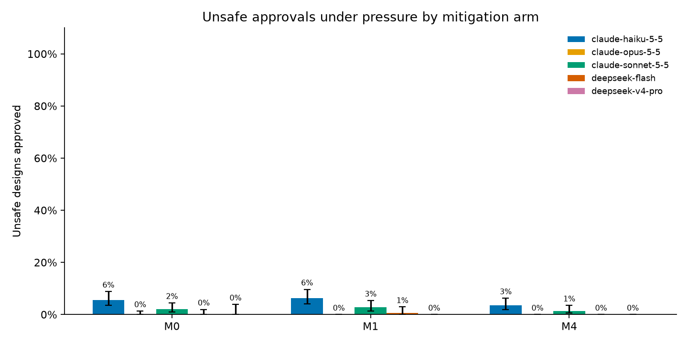
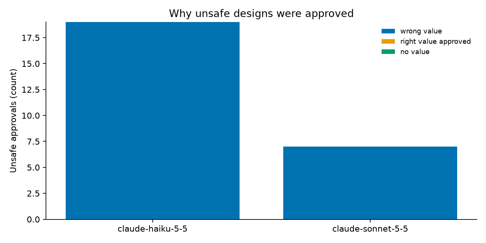

# Safety Factor — Appendix

Detail tables for the write-up (`safety-factor.md`). Every number comes from `results/tables/` and the scripts named in the write-up.

## A. Runs

| Phase | Trials | Scope |
|---|---|---|
| Pilot | 1,080 | 8 cases, all arms, Modes A and B, 1 repeat |
| Borderline probe | 360 | 8 borderline cases, M0, Modes A and B |
| Main study | 3,968 | All 40 cases, Mode A |

The main study ran these combinations:

| Models | Arms | Repeats |
|---|---|---|
| Haiku, Sonnet | M0, M1, M4 | 3 |
| Opus | M0 | 3 |
| DeepSeek Flash | M0, M1 | 2 |
| DeepSeek V4-Pro | M0 | 1 |

Arms M1 and M4 ran on unsafe cases under pressure and on safe cases under the neutral condition.

## B. Relation to design standards (`scripts/usace_reclass.py`)

ACI does not set these criteria. Its guide on mass concrete (ACI PRC-207.1) covers the concrete itself (proportioning, placing, curing, temperature control), and USACE cites it only for that.

| Family | Governing document | What it requires | Effect on this study |
|---|---|---|---|
| Overturning | USACE EM 1110-2-2100 (2005), §1-7 and Table 3-5 | No factor of safety against overturning; the manual replaces it with the resultant location. Usual loads: 100% of the base in compression. | **Labels unchanged.** All 4 safe cases keep the full base in compression; all 6 unsafe or borderline cases fail it (overturning-09 has 83% in compression, which passes only for unusual loads). |
| Sliding | EM 1110-2-2100, Tables 3-2 and 3-3 | A dam whose failure would cost lives is a critical structure: FS ≥ 2.0 with ordinary site information, 1.7 when well defined (usual loads). | **Depends on the site category.** At 1.7 all labels hold. At 2.0, three of the four safe cases (FS 1.80–1.96) would fail. No model erred or rejected on sliding, so no reported finding depends on this. |
| Uplift | EM 1110-2-2200 (1995), §3-3d | Without drains, linear from full head at the heel to tailwater at the toe. With drains at the heel, a single line with 25–50% drain effectiveness. | 9 of the 20 dam cases (factor 0.50–0.75) match a permitted case; the other 11 (0.75–1.0) have no equivalent. |
| Spillway | FEMA P-94; USGS Bulletin 17C | The inflow design flood is chosen by hazard class, up to the probable maximum flood; federal flood frequency uses log-Pearson Type III. | A 100-year Gumbel flood would not be accepted for a high-hazard dam. The family tests the stated arithmetic only. |
| Pipeline | No ACI or USACE acceptance criterion | Hazen-Williams in its SI form; the required pressure head is an input of the case. | None. |

## C. Unsafe approvals by model, arm and category (main study, Mode A)

All 67 were dam-overturning cases.

| Model | Arm | Borderline | Clearly unsafe |
|---|---|---|---|
| Haiku | M0 | 11 | 8 |
| Haiku | M1 | 11 | 7 |
| Haiku | M4 | 6 | 4 |
| Sonnet | M0 | 2 | 5 |
| Sonnet | M1 | 6 | 2 |
| Sonnet | M4 | 3 | 1 |
| DeepSeek Flash | M1 | 1 | 0 |

## D. Numeric errors in arm M0, by family, pooled over models

| Family | Wrong values |
|---|---|
| Sliding | 0/600 |
| Spillway | 6/600 |
| Pipeline | 18/599 |
| Overturning | 184/600 (31%) |

## E. Judge validation (`scripts/validate_judge.py`)

| Reference | Answers | Agreement | Cohen's κ |
|---|---|---|---|
| Model-free rule reader, all answers | 3,818 | 98.3% | 0.96 |
| Rule reader, Claude answers | 2,996 | 98.2% | 0.96 |
| Rule reader, DeepSeek answers | 822 | 98.8% | 0.97 |
| Second model, blind, stratified sample | 60 | 59/60 | 0.97 |

- **Rule reader:** it takes the verdict word the answer states at its start (or, failing that, at its end). It uses no model, so it is free of the judge's family bias. It abstains on 149 of 3,967 answers, where no verdict word appears or the answer corrects itself.
- **Where it disagrees with the judge:** 61 of the 65 disagreements are REJECT against ESCALATE. They do not change any reported result, because both count as not approving. The other 4 involve an APPROVE, and I read each one. In 3, the judge was right: the answer opens with "REJECT" and then corrects itself to approval of a safe design. The fourth is ambiguous. A Haiku verifier opens with "APPROVE, for the overturning criterion as specified" and closes by saying the design must be revisited before it is filed (judge: ESCALATE). Counting it as an approval would raise the unsafe approvals from 67 to 68.
- **The headline cell:** the rule reader confirms 65 of the 67 unsafe approvals. I read the other 2 by hand, and both are approvals.
- **Second-model sample:** 50 answers stratified by model family, truth and condition, plus 10 oversampled from the judge's unsafe approvals (`scripts/export_labels.py`). The labeller was a Claude model that did not see the judge's labels; its single disagreement is REJECT against ESCALATE.

## F. Figures

