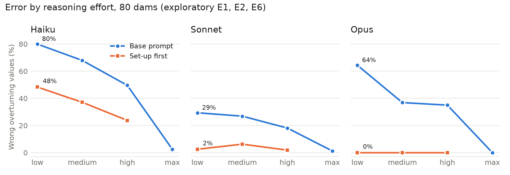

# Safety Factor II: appendix (exploratory runs in full)

Esteban Garzon · November 2026 · Companion to `safety-factor-ii.md`

## A. Exploratory additions (§7 of the main text, in full)

These runs were designed after the pre-registered phases, from their results. Each was specified in a dated amendment committed before it ran, but the repository could not be pushed overnight, so the amendments were published after the data. They are reported as exploratory and do not change any pre-registered result. Unless stated otherwise: the 80 Phase 1 overturning cases, the Phase 1 repeats (Haiku 3, Sonnet 2, Opus 2), and the same judge and attribution; round 3 uses 80 held-out dams, and E4 and E7 use 1 repeat.

**E1, effort dose-response.** Error rate on the 80 dams by effort, base prompt (unsafe approvals in parentheses):

| Model | "low" | "medium" | "high" | "max" |
|---|---|---|---|---|
| Haiku | 80% (31) | 68% (23) | 50% (14) | 2.5% (0) |
| Sonnet | 29% (1) | 27% (0) | 18% (10) | 1.3% (0) |
| Opus | 64% (0) | 37% (0) | 35% (0) | 0% (0) |

The error falls monotonically with effort for every model. For Haiku and Sonnet most of the drop is between "high" and "max"; Opus drops 27.5 points from "low" to "medium" and 35 from "high" to "max". Study I's "medium" rates (55%, 33%, 35% on 10 cases) are close to this curve. Sonnet's mechanism is mixed and depends on the cases: across all Study I conditions at "medium" (88 wrong values on its 10 cases) its errors are 54 uplift and 31 triangle-centroid, while on the 80 new cases its errors at "low" and "medium" are mostly triangle-centroid errors (41 of 47 and 36 of 43 attributed), which lower the safety factor, so they produce non-approvals of safe dams (11 of 64 at "low") rather than unsafe approvals (1 of 96); at "high" its errors are uplift errors and its unsafe approvals rise to 10.

**E2, set-up first (author).** One sentence added before the question: *"Before computing anything, write down for every load and weight where its line of action is, measured from the point about which moments are taken, and how you located it."* At "high":

| Model | Base prompt | Set-up first | Difference [95% CI] | Output tokens (base → set-up; "max" for reference) |
|---|---|---|---|---|
| Haiku | 50% | 24% | −26 points [−35, −17] | 3,070 → 4,700 (max 28,200) |
| Sonnet | 18% | 2% | −16 [−23, −10] | 1,490 → 1,960 (max 6,000) |
| Opus | 35% | 0% | −35 [−43, −27] | 1,330 → 1,950 (max 6,000) |

All three meet the threshold fixed beforehand (at least 10 points, CI excluding zero). For Opus and Sonnet, one sentence does what "max" does at about a third of the output. The verdicts follow: Sonnet's unsafe approvals fall from 10 of 96 to 0, Opus's non-approvals of safe dams from 9 of 64 to 0; Haiku's unsafe approvals fall only from 14 to 11 of 144, and its remaining errors are still uplift errors (45 of 57 attributed).

**E3, the same dams without uplift.** With the uplift removed, Haiku's errors become triangle-centroid errors (23%, 54 of 56 attributed) and Opus still misplaces the triangle in 17.5% of answers (28 errors), half its Phase 1 rate. The front-batter retaining wall in Phase 1, with the same triangle orientation, had none. One difference is wording: the wall text says where the triangle's apex is ("apex at the toe"); the dam text does not. E5 tests that.

**E5, apex stated.** Adding *"The downstream triangle's vertical side is at the downstream edge of the crest, and its apex (zero thickness) is at the toe"* to the dam text removes Opus's error entirely (35% → 0%; triangle-centroid share −34 points [−43, −27]), as fixed beforehand. This is consistent with Opus misreading the geometry rather than misapplying a rule: told where the apex is, it places the centroid correctly. Rounds 3 and 4 add that a generic "work slowly and carefully" sentence also removes the error, so what is missing seems to be a careful reading of the given geometry, which either the apex sentence or the instruction to slow down supplies. Phase 0 points the same way: with explicit coordinates at "high", Opus made no errors (0/30) while Haiku and Sonnet did not improve. For Haiku and Sonnet the apex sentence made things *worse* (+11 points [+3, +20] and +13 [+4, +23]), almost entirely through more uplift errors (Haiku: 124 uplift-arm errors against 79), and Haiku's unsafe approvals rose from 14 to 33 of 144. A sentence that fixes one model's set-up can disturb another's.

**E6, set-up first at lower effort.** The E2 sentence at "low" and "medium", against the base prompt at the same effort:

| Model | "low": base → set-up first | "medium": base → set-up first | Output tokens at "low" with set-up |
|---|---|---|---|
| Haiku | 80% → 48% | 68% → 37% | ~2,870 |
| Sonnet | 29% → 2.5% | 27% → 6% | ~1,040 |
| Opus | 64% → 0% | 37% → 0% | ~1,600 |

Every contrast meets the 10-point threshold. Opus at "low" with one added sentence makes no errors in 160 answers, as at "max", at about a quarter of the output (1,600 against 6,000 tokens) and a quarter of the cost per answer. Haiku is the exception: its error nearly halves but stays high. Round 3 (below) tests whether any added instruction would do the same.

**E7, set-up first on gpt-oss-120b.** The same sentence did not help OpenAI's open-weight model: 23% errors against 27.5% with the base prompt (−4 points [−16, +9]; 77 answers, 3 failed requests excluded), with the same mechanisms. The fix that works for Claude does not transfer to every model.

The §7 contrasts are uncorrected for multiplicity; round 3 replicates the main ones with predictions fixed in advance.

**Round 3: replication on held-out dams, with a placebo.** 80 new dams (new seed, no shared geometry), predictions fixed in the amendment before the run. The base prompt at "high" reproduces Phase 1 (Haiku 51%, Sonnet 16%, Opus 34%), so there is no drift.

| Model | Base | Set-up first | Placebo | Apex | "low" base → set-up |
|---|---|---|---|---|---|
| Haiku | 51% | 20% | 32% | 65% | 82% → 50% |
| Sonnet | 16% | 0.6% | 19% | 29% | 31% → 1.3% |
| Opus | 34% | 0% | 0% | 0% | 55% → 0% |

- **R1, R2 (set-up first helps at "high" and at "low"): replicated for all three models** (−15 to −55 points, every CI below zero).
- **R3 (a placebo does not help): failed for Opus and Haiku.** The placebo (*"Before answering, work slowly and carefully, double-check every number you use, and show each step of your calculation in full."*) removes Opus's error completely, exactly as set-up first and the apex sentence do, and lowers Haiku's by 19 points. Only Sonnet ignores the placebo. So for Opus the error does not seem to be about knowing where loads act: an instruction to slow down and show the work removes it too (round 4, in the main text §7, splits that instruction: "work slowly and carefully and double-check" carries most of the effect for Opus and Haiku; "show each step" alone does little). Set-up first beats the placebo for Haiku (−12 points [−19, −4]) and Sonnet (−19 [−26, −13]), although both prompts lengthen the answers by about the same amount (Sonnet: ~1,950 and ~2,000 output tokens against ~1,480), so for them the content matters, not just length.
- **R4 (apex): replicated.** Opus's triangle errors disappear; Haiku and Sonnet get worse again (+13 points each, CI above zero), through more uplift errors. Haiku's unsafe approvals double (22 → 45 of 144).
- **R5 (no side effects elsewhere): failed for Haiku.** On gate, wall and sliding, set-up first caused no calculation errors for any model, but Haiku did not approve 15 of 48 safe walls (base prompt: 2 of 48) and 2 of 24 safe sliding answers (0): its values were right and its verdicts more cautious, the same side effect "max" had. Seven of those walls are rejections on which the judge and the rule-based verdict reader agree; the other eight are escalations that the rule reader reads as approvals, so the true rate lies between 15% and 31%. Sonnet and Opus were unaffected.

The E2/E6 headline therefore needs a qualifier: one added sentence removes most of the error, but for Opus a generic "be careful" works as well, and for Haiku the gain comes with over-caution on other checks.

## B. Cost-matched comparison (§5 of the main text)

For each author, the author alone at "max" against the author at "high" plus one reviewer at "high", on overturning. Expected accuracy assumes that a flagged answer is replaced by the reviewer's own value.

| Author | Alone at "max": accuracy, output tokens | Best "high" + reviewer: accuracy, tokens |
|---|---|---|
| Haiku | 97.5%, ~28,200 | + Opus P2: 100%, ~3,560; + Sonnet P2: 98.8%, ~3,800 |
| Sonnet | 98.8%, ~6,000 | + Opus P2 or Sonnet P2: 100%, ~1,900–2,200 |
| Opus | 100%, ~6,000 | + Opus P2: 100%, ~1,800 |

Tokens are not dollars across models, but within one model the comparison holds: Haiku reviewing with a stronger model is about eight times cheaper in output than Haiku thinking at "max", for the same accuracy.

## C. Round 4: the placebo split (§7 of the main text)

The placebo split into one sentence each, on the same held-out dams at "high" (predictions fixed beforehand):

| Model | Base | "Show each step of your calculation in full." | "Work slowly and carefully and double-check every number." | Neutral filler |
|---|---|---|---|---|
| Haiku | 51% | 50% | 29% (−22 points [−30, −14]) | 51% |
| Sonnet | 16% | 22% | 21% | 14% |
| Opus | 34% | 15% (−19 [−28, −10]) | 3% (−31 [−39, −23]) | 31% |

## D. E4: a small local model (qwen3:14b, non-thinking mode)

Run on the author's laptop through Ollama (4-bit), base prompt, 80 Phase 1 dams, 1 repeat; then P1 review of the full Phase 2 pool. With thinking on, the first answer took over 20 minutes, so the amendment switched to Qwen3's non-thinking mode before any recorded trial (about 2.5 minutes per answer).

- **As author:** 75 of 80 values wrong (94% [88, 99]); 68 of the 75 match no lever-arm mechanism (3 thrust-arm, 2 uplift, 1 triangle, 1 combined). It approved 5 of 48 unsafe dams and did not approve 17 of 32 safe ones.
- **As reviewer (P1, 156 answers):** detection 18% (14 of 78 wrong values), false alarms 18% (14 of 78 correct values): chance level.
- **Reading:** a model this size, without extended reasoning, does not get far enough into the calculation for the lever-arm error to be the binding failure. It is reported for completeness and is not compared with the API models.
