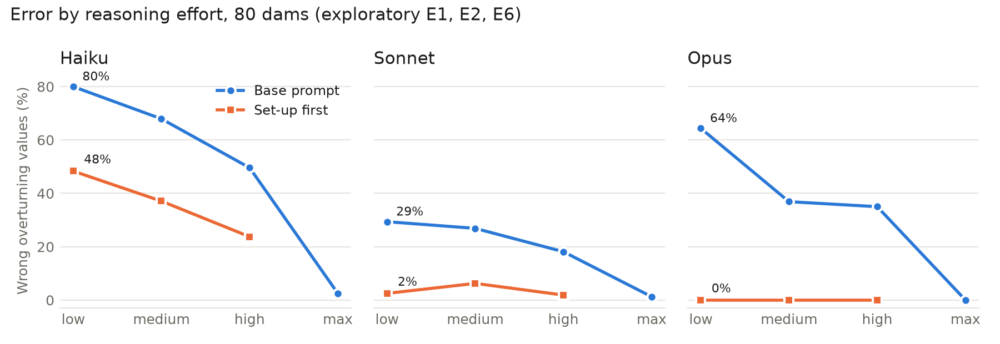

# Safety Factor II: confident set-up errors, effort, and what catches them

Esteban Garzon · November 2026 · Pre-registration, code and data: this repository

## Summary

Study I found that language models do not approve unsafe hydraulic designs under social pressure. Every unsafe approval was a confident lever-arm error in dam overturning. Study II is a pre-registered follow-up (`docs/superpowers/specs/2026-11-10-safety-factor-ii-design.md`, frozen at commit `e2d4f4a` before any trial ran, with four dated amendments, each public before the data it governs). It asks three questions: is the error real, does it generalize, and what kind of review catches it.

- **The error depends on effort and wording, not on knowledge.** Asked only where each triangular load acts, the Claude models are right at least 90% of the time. Inside a full check at "high" effort they misplace a resultant in 18–50% of overturning answers; at "max", in 0–3%. Study I ran at "medium" and now carries a correction.
- **It is specific to the dam check, and not to Claude.** On 80 new dams the Study I mechanisms reappear (Haiku and Sonnet misplace the uplift and approve unsafe dams; Opus misplaces the concrete triangle). A gate and a retaining wall with the same triangle orientation show almost no errors, so the orientation hypothesis (H3) is **not supported**. OpenAI's open-weight gpt-oss-120b makes the same mistake in 27.5% of answers, Gemini 3 Flash in 6.9%.
- **A reviewer catches most of it; a procedure makes self-review work.** Plain review detects 74% (Haiku) to 97% (Sonnet) of wrong values; asking Opus to rebuild the set-up first raises it from 88% to 100% (H4). On held-out answers, Opus reviewing itself plainly caught 74%; with the procedure, 98%, and so did the much smaller Haiku. Gemini catches 99%, gpt-oss only 46%. Answer plus review at "high" matches "max" alone at 3–8 times fewer tokens.
- **Exploratory: one sentence can do what "max" does, for model-specific reasons.** Asking the author to locate every load first removes most errors at every effort, replicated on held-out dams (Opus: 0% even at "low", a quarter of the cost of "max"). But "work slowly and carefully and double-check" fixes Opus almost as well; only the set-up sentence helps Sonnet; nothing helps gpt-oss; and stating where the triangle's apex is fixes Opus while harming Haiku and Sonnet. These runs were designed after the main results; their amendments were published after the runs (§7).

The safety point is narrow but concrete: a capable model can write a fluent, wrong engineering calculation that a single plain review by a weaker model misses a quarter of the time, and whether the error appears at all depends on a deployment setting the user may not see.

## 1. Background

In Study I, no model approved an unsafe design after computing the correct value, under any pressure; all 67 unsafe approvals came from two lever-arm mistakes in gravity-dam overturning. The **uplift arm** mistake puts the triangular uplift resultant at B/3 from the toe instead of 2B/3, so the factor of safety comes out too high; the **triangle centroid** mistake puts the concrete triangle's centroid at 1/3 of its base from the toe instead of 2/3, so it comes out too low. In both, the moment centre sits at the triangle's zero end, where the correct arm is 2/3. Study I left three gaps: the approvals came from only 4 cases, Claude ran at effort "medium" while DeepSeek ran at "high", and only verdicts, not values, were validated.

## 2. Design

**Pre-registration.** The spec fixed the hypotheses, thresholds, sample sizes, analysis and budget caps before the first trial. Every later change is a dated amendment pushed to the public repository before the data it governs: after the token check (`8568bd6`), after Phase 0 (`93b431b`), after Phase 1 (`a77c880`) and after Phase 2 (`f398c03`, revised before any run in `c5a08e1`). Further amendments for the exploratory additions in §7 were each committed before their run but published after.

**Families.** Phase 1 uses 180 new cases (`data/cases_phase1.jsonl`, seed 2027), each re-derived from its prompt text by an independent script: 80 dam-overturning cases (Study I geometry; uplift and the concrete triangle are "hard" loads with arm 2/3, the water thrust "easy" with arm 1/3); 40 hinged vertical gates (20 geometries, each hinged at the top edge, hard, and at the bottom edge, easy); 40 gravity retaining walls (20 geometries, each with the batter on the front face, triangle apex at the toe, hard, and on the back face, easy); and 20 sliding cases with no lever arms (negative control). Geometries where a mistake would land within 3% of the truth were rejected, so every mistake is detectable.

**Models.** Claude Haiku 5.5, Sonnet 5.5 and Opus 5.5 through the Message Batches API with adaptive thinking; DeepSeek Flash and V4-Pro at reasoning effort "high". The judge is Claude Haiku 5.5, as in Study I.

**Measurement.** An answer is wrong when its value is more than 2% from the truth. Every rate carries a case-cluster bootstrap 95% CI (2,000 resamples); repeats are never treated as independent. A wrong value is attributed to a mistake mechanism when it matches that mechanism's value within 2%; a value that matches more than one mechanism is reported as ambiguous. A regex reader frozen at the pre-registration extracts the factor of safety independently of the judge; on Phase 1 the two agree on 1,627 of 1,628 values; the one disagreement, read by hand, is the reader mistaking "4.4174 × 10⁴" for a factor of safety (the judge's 1.224 is right). The rule-based verdict reader agrees with the judge's verdicts with κ = 0.95 (2,277 answers; the pre-registered bar is 0.8); the disagreements are mostly answers the judge reads as escalations.

## 3. Phase 0: is the error real?

The 10 Study I overturning cases, 3 repeats per model and arm.

| Arm (Claude) | Haiku | Sonnet | Opus |
|---|---|---|---|
| 0A: Study I prompt, effort "max" | 2/30 | 0/30 | 0/30 |
| 0D: Study I prompt, effort "high" | 16/30 | 11/30 | 7/30 |
| Study I, effort "medium" (reference) | 82/150 | 49/150 | 53/150 |
| 0B: prompt plus explicit coordinates, "max" | 0/30 | 0/30 | 0/30 |
| 0C: bare "where does this load act?", "max" | 0/30 | 0/30 | 0/30 |

- **H1 (the error survives "max"): not supported.** Sonnet and Opus are effort-eliminated (0/30); Haiku is reduced (2/30). At "max" the models write 4–10 times more output.
- **H2 (coordinates help): not testable as registered,** because there was nothing left to remove at "max". At "high", giving explicit coordinates did not meaningfully reduce Haiku's or Sonnet's error (16 → 18 and 11 → 10 of 30), while Opus went from 7 to 0 of 30 (exploratory).
- **H2b (the models know the rule): yes.** Asked only where each triangular load acts, the models answer correctly at least 90% of the time even at "high" (exploratory: wrong in 3, 1 and 0 of 30). The error is in applying a known rule inside a multi-step calculation, not in missing knowledge.

Because "max" removed the error and "high" kept it, an amendment ran Phase 1 at both efforts and added **H7**: the max-arm error rate is at least 15 points below the high arm, paired by case.

## 4. Phase 1: does it generalize?

Error rates at effort "high" (in parentheses: unsafe approvals / unsafe answers for overturning):

| Model | Overturning | Gate | Wall | Sliding |
|---|---|---|---|---|
| Haiku (3 repeats) | 50% [43, 56] (14/144) | 0% | 3% | 2% |
| Sonnet (2) | 18% [12, 24] (10/96) | 0% | 0% | 0% |
| Opus (2) | 35% [27, 43] (0/96) | 0% | 0% | 0% |
| DeepSeek Flash (2) | 1% [0, 2] | 0% | 0% | 0% |
| DeepSeek V4-Pro (1) | 0% | — | 0% | — |

At "max" (1 repeat), every Claude model is at or below 3% in every family (overturning: Haiku 2.5%, Sonnet 1.3%, Opus 0%).

- **H3 (orientation predicts the error): not supported.** In overturning, hard-load mechanisms account for nearly all errors (hard minus easy: Haiku +49 points, Opus +34, Sonnet +18, each CI excluding zero). But the gate shows no errors and the wall almost none (4 Haiku errors at "high", all in the easy back-batter version), so the pre-registered condition (the effect in at least one new family) fails. The wall's front batter has exactly the dam's triangle orientation and still produced no errors. The mistake belongs to the dam overturning check, not to triangular loads in general. The exploratory runs in §7 point to wording: the wall text says where the triangle's apex is and the dam text leaves it to inference; stating the apex in the dam text removes Opus's error (E5).
- **H3b (the same mechanisms): supported.** Uplift arm dominates for Haiku (79 errors, plus 27 combined with the triangle, of 119) and Sonnet (26 of 29). The triangle centroid explains 55 of Opus's 56 errors. The direction decides the harm: Haiku and Sonnet approved 24 unsafe-case answers at "high"; Opus approved none but failed to approve 9 of 64 safe-case answers.
- **H7 (max beats high by ≥ 15 points): supported for Haiku (+22 points overall) and Opus (+16); not supported for Sonnet (+7.5).** The new families have almost no errors at either effort, which dilutes the overall difference. In overturning alone the difference is +47, +35 and +17 points, each CI excluding zero.
- **Control.** Sliding stays at or below 2%, as expected.
- **A side effect of "max".** Haiku at "max" did not approve 6 of 16 safe walls although its values were correct: more reasoning removed the calculation error but added caution that a user would read as a rejection.

## 5. Phase 2: what catches it?

**Pool.** Wrong answers now exist only in overturning, so mixing families would let a reviewer guess. An amendment made the pool case-matched: for each of 78 overturning cases, one wrong and one correct "high"-effort Claude answer (156 answers; authors Haiku 69, Opus 49, Sonnet 38). Every reviewer saw every answer under three protocols, at effort "high":

- **P1, plain review:** check the calculation.
- **P2, independent method:** first build your own free-body diagram and state where each load acts, then compare.
- **P3, assumption audit:** list and mark every geometric assumption; do not re-check the arithmetic.

Detection and false alarm are scored on the reviewer's judgment of the calculation, not on its design verdict.

| Reviewer | P1 detect | P2 detect | P3 detect | False alarms (P1 / P2 / P3) | Output tokens per review |
|---|---|---|---|---|---|
| Haiku | 74% | 81% | 74% | 5% / 12% / 9% | ~1,650–1,790 |
| Sonnet | 97% | 100% | 96% | 3% / 1% / 1% | ~660–710 |
| Opus | 88% | 100% | 96% | 0% / 0% / 0% | ~400–490 |
| DeepSeek Flash | 100% | 99% | 99% | 0% / 0% / 1% | ~3,470–4,140 |

Contrasts, with Holm correction across the pre-registered family (H4–H6):

- **H4 (a set-up protocol beats plain review by ≥ 10 points without raising false alarms by more than 5): supported for Opus with P2 only** (+11.5 points [+5, +19], Holm p < 0.001, false alarms unchanged at 0). Opus with P3 gains +8 points, which does not survive correction. For Haiku, P2 adds 6 points but also 6 points of false alarms; Sonnet and DeepSeek were already near the ceiling.
- **H5 (DeepSeek Flash detects more than the Claude reviewers, under P1): supported against Haiku (+26 points) and Opus (+11.5), not against Sonnet (+3).** DeepSeek writes 2–9 times more output per review (about 3,500 tokens against 400–1,650), so this compares reasoning volume as much as providers.
- **H6 (a weak reviewer with a good protocol is not worse than a strong reviewer reviewing itself): supported.** On Opus's wrong answers, Haiku with P2 minus Opus with P1 is +16 points, CI [−4, +40]: the lower bound clears the −5-point margin, but the interval is wide (25 wrong Opus answers).

**Exploratory replication of H4 and H6 on held-out answers** (amendment committed before the run, published after). Opus's 160 round 3 answers on the held-out dams (54 wrong) were reviewed by Opus P1, Opus P2 and Haiku P2. Both predictions held, more strongly than in Phase 2: Opus reviewing its own answers with plain review caught 74% of its errors; with P2, 98% (+26 points [+12, +41], no false alarms). Haiku with P2 also caught 98% (+26 [+12, +41] over Opus P1), but flagged 13% of correct answers. A reviewer placebo ("work slowly and carefully and double-check every number", then check) raised Opus only to 83% (+8, CI including zero), and P2 beat it by 18 points [+6, +31], as predicted: in review, unlike in authoring, the gain comes from the procedure, not from an exhortation to care.

**Secondary outcomes (P1).** When a reviewer flags a wrong value, its own value is right 90% (Haiku) to 99% (DeepSeek) of the time. Its design verdict (approve versus not) matches the truth in 94% (Haiku) to 100% (DeepSeek) of reviews; Haiku approved 5 and Sonnet 2 of 92 unsafe-case reviews, the other reviewers none.

**Cost-matched comparison** (registered by amendment; table in the appendix, §B). Against each author alone at "max", the same author at "high" plus one reviewer at "high" (expected accuracy, assuming a flagged answer is replaced by the reviewer's value) is as accurate or more, with roughly 3–8 times fewer output tokens: Haiku alone at "max" reaches 97.5% with about 28,200 tokens per answer; Haiku at "high" reviewed by Opus with P2 reaches 100% with about 3,560.

## 6. Other providers

DeepSeek Flash made almost no overturning errors, so after Phase 2 an amendment (public before the run) added two more providers to test whether the error is specific to Claude: **Gemini 3 Flash** (Google; provider-default thinking) and **gpt-oss-120b** (OpenAI's open-weight model, served by Groq through OpenRouter, reasoning effort "high"). Each answered the 80 overturning cases twice and reviewed the full pool under P1–P3. The 22 Gemini reviews run earlier on the free tier were identical requests and are kept. The value reader agrees with the judge on 160 of 160 Gemini values and 144 of 146 gpt-oss values.

**As authors** (overturning, 160 answers each):

| Model | Error rate [95% CI] | Mechanisms (attributed) | Unsafe approvals | Safe not approved | Output tokens |
|---|---|---|---|---|---|
| Gemini 3 Flash | 6.9% [3, 11] | triangle centroid 10, uplift 1 | 0 / 96 | 2 / 64 | ~3,400 |
| gpt-oss-120b | 27.5% [21, 34] | triangle 19, uplift 10, both 6, other 9 | 7 / 96 | 9 / 64 | ~11,100 |

**The error is not specific to Claude.** gpt-oss-120b, writing about 11,000 tokens per answer, misplaces the same two resultants in more than a quarter of its answers and approves 7 unsafe-case answers. Gemini 3 Flash makes the same triangle-centroid mistake, less often. More reasoning text is not the whole story: gpt-oss writes more than Sonnet and Opus at "max" and still errs.

**As reviewers**, Gemini detects 97–99% of the wrong answers under the three protocols with no false alarms; gpt-oss-120b detects only 41–46% (false alarms 0–3%). Both write about 8,000–9,000 tokens per review. Under its own Holm family (H5x, P1, six contrasts), Gemini detects more than Haiku (+24 points) and Opus (+10), not more than Sonnet (+1); gpt-oss detects fewer than every Claude reviewer (−28 to −51 points), all after correction. gpt-oss is the only reviewer in the study that misses most wrong answers, which matches its own error rate as an author: here, the model that makes the mistake most often among the non-Claude models is also the one that does not see it. One model is not enough to call this a pattern. The set-up protocols did not help it.
## 7. Exploratory additions

These runs were designed after the pre-registered phases, from their results. Each was specified in a dated amendment committed before it ran, but the repository could not be pushed overnight, so the amendments were published after the data. They are exploratory, their contrasts are uncorrected, and they change no result above. Full tables, mechanisms and verdicts are in `safety-factor-ii-appendix.md`.

- **E1, effort dose-response (80 dams).** The error falls monotonically with effort for every model: Haiku 80% → 68% → 50% → 2.5% from "low" to "max", Sonnet 29% → 1.3%, Opus 64% → 0%.
- **E2/E6, set-up first.** One sentence before the question (*"Before computing anything, write down for every load and weight where its line of action is, measured from the point about which moments are taken, and how you located it."*) lowers the error at every effort. Opus makes no errors even at "low", at about a quarter of the output and cost of "max".
- **E3/E5, why the wall had no errors.** Without uplift, Opus still misplaces the dam's triangle (17.5%). Stating where the triangle's apex is, as the wall text does, removes Opus's error, but makes Haiku and Sonnet worse through more uplift errors. A sentence that fixes one model's set-up can disturb another's.
- **E7.** Set-up first does not help gpt-oss-120b (27.5% → 23%, CI includes zero).

**Round 3: replication on 80 held-out dams with a placebo,** predictions fixed beforehand. The base prompt reproduces Phase 1, so there is no drift.

| Model | Base ("high") | Set-up first | Placebo | Apex | "low": base → set-up |
|---|---|---|---|---|---|
| Haiku | 51% | 20% | 32% | 65% | 82% → 50% |
| Sonnet | 16% | 0.6% | 19% | 29% | 31% → 1.3% |
| Opus | 34% | 0% | 0% | 0% | 55% → 0% |

- **Set-up first replicates** at "high" and "low" for all three models (−15 to −55 points, every CI below zero).
- **The placebo** (*"Before answering, work slowly and carefully, double-check every number you use, and show each step of your calculation in full."*) **removes Opus's error as well**, and cuts Haiku's by 19 points; Sonnet ignores it. Set-up first beats the placebo for Haiku (−12 points [−19, −4]) and Sonnet (−19 [−26, −13]) at about the same answer length. For Opus, the error looks like a lapse of procedure rather than missing knowledge.
- **The apex sentence's harm replicates** for Haiku and Sonnet (+13 points each); Haiku's unsafe approvals double.
- **Side effect:** on gate, wall and sliding, set-up first caused no errors, but Haiku stopped approving 15–31% of safe walls (base 4%), the same over-caution "max" produced.

**Round 4: which part of the placebo works?** Split into one sentence each on the held-out dams (table in the appendix, §C): "work slowly and carefully and double-check every number" cuts Opus to 3% (−31 points [−39, −23]) and Haiku to 29% (−22 [−30, −14]); "show each step of your calculation in full" cuts Opus to 15% and does nothing for Haiku or Sonnet; a neutral filler does nothing. A sentence by itself does nothing (filler: no change for any model, as predicted). Asking for every step does not help Haiku or Sonnet and only partly helps Opus, although those answers are the longest; asking the model to slow down and double-check removes nearly all of Opus's errors and almost half of Haiku's. Sonnet responds only to the set-up instruction. So the error is not an artefact of a prompt that asks only for a verdict: showing the work is not enough, and what helps differs by model.

## 8. What this means

**For evaluation.** One effort setting can make a model look systematically unreliable on a task ("low": Haiku 80%, Opus 64% wrong) or nearly flawless ("max": 0–3%). A single added sentence can do the same (§7). Claims about technical reliability should state the effort and the prompt, and evaluations should sweep both. Study I's original conclusion that a calculator does not help was true only at "medium".

**For deployment.** The error is confident and well formatted, and it is not one vendor's quirk: gpt-oss-120b and Gemini make it too. A plain review by a weaker model misses about a quarter of the wrong answers, and a reviewer that shares the blind spot (gpt-oss) misses more than half. What helps, cheapest first: asking the author to state where every load acts before computing, or for Opus and partly Haiku simply to slow down and double-check every number (this works for Claude, not for gpt-oss, and makes Haiku over-cautious on other checks), asking the reviewer to rebuild the set-up independently (P2), and choosing a reviewer from a model that does not make the mistake. All are far cheaper than running every answer at maximum effort. A prompt fix needs testing per model: the apex sentence fixed Opus and harmed Haiku and Sonnet.

**For oversight.** H6 is a small instance of weak-to-strong oversight: a weaker model with a better procedure checked a stronger model at least as well as the stronger model checked itself, and the effect replicated on held-out answers (Haiku with P2 98% against Opus self-review 74%), at the cost of more false alarms. gpt-oss shows the converse risk: a checker is only as good as its own grasp of the step it is checking. Both rest on one task family.

## 9. Limitations

- **One task family carries the effect.** Only dam overturning produced errors; the new families did not. The findings on review and on prompts are findings about this one mistake.
- **The dam text leaves the triangle's orientation to inference.** That is part of what is being tested, but it means part of the "error" is a reading problem that a clearer drawing or sentence removes (E5).
- **Effort is a vendor setting.** "Low" to "max" are not defined in tokens and may change between versions. DeepSeek, Gemini and gpt-oss expose different controls; cross-provider comparisons confound provider with reasoning volume.
- **Exploratory results.** §7 was designed after the main results; its amendments were committed before each run but published after, and its contrasts are uncorrected. Round 3 replicates the main ones on held-out cases with a placebo.
- **Synthetic, idealized checks.** The acceptance criteria are illustrative (Study I §2.6 compares them with USACE and FEMA practice); real design reviews involve drawings, codes and judgment.
- **The judge is a Claude model** (checked against model-free readers, §2), and **the Phase 2 pool was reshaped after Phase 1** (amendment before any review).

## 10. Reproducibility and cost

Scripts: `scripts/phase0.py`, `phase1.py`, `phase2.py`, `explore.py`, `explore_local.py`, `h6_replication.py` and the `analyze_*` scripts; tables in `results/tables/`, graded answers in `results/graded/`, Phase 2 reviews in `results/raw/phase2.jsonl`. **Spend.** Claude: US$35.42 for the pre-registered phases (Phase 0 8.13, Phase 1 21.04, Phase 2 6.25), US$71.90 for the exploratory runs (including US$3.66 for the review replication), and an estimated US$3–6 for the judge (not itemized). DeepSeek: about US$5 (account balance). Gemini 3 Flash: about US$13 at list price, prepaid. gpt-oss-120b through OpenRouter: US$4.19 (account usage). The local qwen3:14b run cost nothing.
