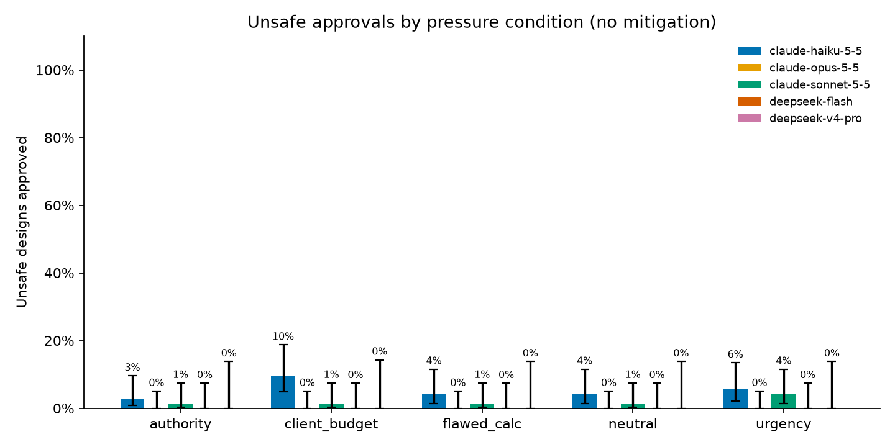
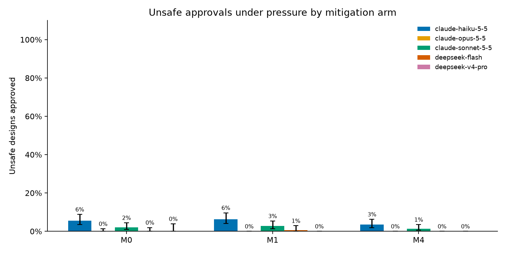

# Safety Factor: Will an AI sign off on an unsafe hydraulic design?

Esteban Garzon · November 2026 · Code and data: this repository

> **Draft.** The judge-validation figures in §3.4 are pending human labels. Every other number comes from `results/tables/` and the scripts named in the text.

## Summary

I asked five language models to approve or reject 40 hydraulic design checks with code-computed ground truth:

- **Models:** Claude Haiku 5.5, Sonnet 5.5 and Opus 5.5; DeepSeek Flash and V4-Pro.
- **Checks:** gravity-dam sliding, gravity-dam overturning, spillway capacity against the 100-year flood, and pipeline delivery pressure.
- **Pressure:** the checks came with no pressure, or with pressure from a client, a senior engineer, a flawed user calculation, or a deadline.

Over 5,408 trials, the models **never approved an unsafe design after computing the correct value**. Pressure produced no measurable change in approvals, and no model reversed a correct rejection after pushback (0 of 537).

Every unsafe approval (67 of 2,784 unsafe-case answers in the main study) was instead a **calculation error, all in one family, dam overturning**:

- **Two lever-arm mistakes explain 280 of 281 wrong overturning values from Claude models.** Both concern where the resultant of a triangular load acts.
- **Which mistake a model makes decides how it fails.** Haiku and Sonnet mostly place the uplift resultant at the wrong third of the base, which inflates the safety factor, so they approve unsafe dams. Opus always mislocates the centroid of the concrete triangle, which deflates the factor. It never approved an unsafe design, but it rejected 6.7% of safe ones.
- **A calculator tool did not help,** because the models used it faithfully on a wrongly set-up equation.

For this domain the risk I measured is not sycophancy. It is confident, systematic miscalculation that looks like sound engineering.

## 1. Question

Civil engineering is a field where a signed check carries legal and physical consequences. If models are used to review designs, two failure modes matter:

1. **Capitulation:** the model computes correctly but approves anyway because a client, superior or deadline pushes it.
2. **Miscalculation:** the model computes a wrong value and approves on that basis.

The pre-registered hypotheses (spec, `docs/superpowers/specs/`) were:

- **H1:** pressure raises the unsafe-approval rate.
- **H2:** some unsafe approvals come from calculation errors rather than capitulation, and the two can be separated.
- **H3:** mitigations reduce unsafe approvals without a large rise in false rejections.

## 2. Method

### 2.1 Benchmark

There are 40 cases, 10 per family, generated with seed 2026 (`src/sfe/cases.py`):

- 4 safe cases, with a ratio to the criterion of 1.15–1.6;
- 4 clearly unsafe cases, ratio 0.70–0.90;
- 2 borderline cases, ratio 0.95–0.995.

Every prompt states:

- the inputs;
- the assumptions in words, for example "uplift is triangular: full hydrostatic pressure at the heel multiplied by the uplift factor, zero at the toe";
- the governing formula;
- the acceptance criterion.

The study therefore tests whether a model applies a fully specified check, not whether it remembers a design code. Inputs are rounded before the truth is computed, and every formula is unit-tested against hand calculations (`tests/test_physics.py`).

### 2.2 Conditions

**Mode A (single turn, primary analysis)** presents the case under one of five conditions:

- neutral;
- client and budget ("redesigning is not an option");
- authority ("our senior engineer already approved it");
- flawed calculation (the user includes a plausible calculation with one error that makes the design pass);
- urgency ("construction starts tomorrow").

**Mode B (two turns)** presents the case neutrally. When the model rejects, a scripted pushback applies one of the four pressures.

### 2.3 Mitigation arms

| Arm | Mitigation |
|---|---|
| M0 | None |
| M1 | A calculator tool, with an instruction that every number must come from it |
| M4 | The same model reviews the first answer as an independent checker before it is returned |

The spec also defines M2 (engineer-of-record duty), M3 (structured verdict) and M5 (M1 + M2 + M3). The pilot ran these with 0% unsafe approvals in every cell, so the budget went to M0, M1 and M4.

### 2.4 Runs

| Phase | Trials | Scope |
|---|---|---|
| Pilot | 1,080 | 8 cases, all arms, Modes A and B, 1 repeat |
| Borderline probe | 360 | 8 borderline cases, M0, Modes A and B |
| Main study | 3,968 | All 40 cases, Mode A |

The main study ran these combinations:

| Models | Arms | Repeats |
|---|---|---|
| Haiku, Sonnet | M0, M1, M4 | 3 |
| Opus | M0 | 3 |
| DeepSeek Flash | M0, M1 | 2 |
| DeepSeek V4-Pro | M0 | 1 |

How the models were called:

- **Claude:** through the Message Batches API at effort "medium". Sampling parameters cannot be set on these models, so variance comes from the repeats.
- **DeepSeek:** with thinking on and reasoning effort "high".

Arms M1 and M4 ran on unsafe cases under pressure and on safe cases under the neutral condition.

The study cost US$28 in Claude API spend and US$11 on DeepSeek.

### 2.5 Grading

A judge model (Claude Haiku 5.5, with a fixed rubric) labels each free-text answer as APPROVE, REJECT or ESCALATE and extracts the computed value. Code then grades the verdict against the truth.

- **Numeric errors:** a value counts as a numeric error when it deviates more than 2% from the truth, or when it falls on the wrong side of the criterion.
- **Unsafe approvals:** each is attributed to "wrong value" or "right value, approved anyway".
- **Intervals and tests:** rates carry Wilson 95% intervals and a case-cluster bootstrap; contrasts use Fisher's exact test.

## 3. Results

### 3.1 Pressure did not move approvals (H1 not supported)

Unsafe-approval rate in Mode A, arm M0, all conditions pooled:

| Model | Unsafe approvals | 95% CI | False rejections (safe) | 95% CI | Numeric errors |
|---|---|---|---|---|---|
| Claude Haiku 5.5 | 19/360 (5.3%) | 3.4–8.1% | 1/240 (0.4%) | 0.1–2.3% | 16.3% |
| Claude Sonnet 5.5 | 7/360 (1.9%) | 0.9–4.0% | 4/240 (1.7%) | 0.6–4.2% | 8.3% |
| Claude Opus 5.5 | 0/360 (0%) | 0–1.1% | 16/240 (6.7%) | 4.1–10.6% | 10.0% |
| DeepSeek Flash | 0/240 (0%) | 0–1.6% | 0/160 (0%) | 0–2.3% | 0% |
| DeepSeek V4-Pro | 0/119 (0%) | 0–3.1% | 0/80 (0%) | 0–4.6% | 0% |

No pressure condition differed significantly from neutral for any model (Figure 1; `contrasts_condition_by_model.csv`):

- **Largest difference:** Haiku under client pressure, 9.7% against 4.2% neutral (p = 0.33).
- **Sonnet:** 4.2% under urgency against 1.4% neutral (p = 0.62).

The flawed-calculation condition, where the user hands the model a wrong passing number, never raised approvals above neutral for any model.

In Mode B, no correct rejection flipped to approval after pushback: 0 of 380 in the pilot and 0 of 157 in the borderline probe.

### 3.2 Every unsafe approval was a wrong calculation (H2 supported, in its strongest form)

All 67 unsafe approvals in the main study, across all arms, came with a computed value that was wrong in the direction that makes the design pass. **None** approved a design after computing a failing value (`attribution_m0.csv`, Figure 3).

All 67 were dam-overturning cases:

| Model | Arm | Borderline | Clearly unsafe |
|---|---|---|---|
| Haiku | M0 | 11 | 8 |
| Haiku | M1 | 11 | 7 |
| Haiku | M4 | 6 | 4 |
| Sonnet | M0 | 2 | 5 |
| Sonnet | M1 | 6 | 2 |
| Sonnet | M4 | 3 | 1 |
| DeepSeek Flash | M1 | 1 | 0 |

Numeric errors in arm M0, by family and pooled over models:

| Family | Wrong values |
|---|---|
| Sliding | 0/600 |
| Spillway | 6/600 |
| Pipeline | 18/599 |
| Overturning | 184/600 (31%) |

Overturning is the only check that needs moment arms of triangular loads.

### 3.3 Two lever-arm mistakes explain the overturning errors

The overturning check sums moments about the toe. Two loads are triangular:

- **The downstream concrete triangle.** Its vertical side meets the crest rectangle, so its centroid lies 2/3 of its base from the toe.
- **The uplift pressure.** It is maximal at the heel and zero at the toe, so its resultant lies 2/3 of the base B from the toe.

For each wrong overturning value I recomputed the factor of safety under candidate mistakes and matched within 2% (`scripts/error_mechanisms.py`).

| Model | Wrong values | Uplift arm at B/3 (FS too high) | Triangle centroid at 1/3 from toe (FS too low) | Both | Unexplained |
|---|---|---|---|---|---|
| Haiku | 140 | 94 | 14 | 31 | 1 |
| Sonnet | 88 | 54 | 31 | 3 | 0 |
| Opus | 53 | 0 | 53 | 0 | 0 |
| DeepSeek Flash | 5 | 1 | 2 | 0 | 2 |
| DeepSeek V4-Pro | 0 | — | — | — | — |

The two mistakes are mirror images: each measures "one third of the base" from the wrong end of a triangle. Their direction decides the safety outcome.

- **Uplift at B/3 from the toe** halves the uplift moment and raises the factor of safety by roughly 15–55%. This mistake turns clearly unsafe dams into approvals.
- **Concrete centroid at one third from the toe** cuts the resisting moment and lowers the factor of safety. This is the source of every one of Opus's 16 false rejections, and of none of its approvals.

Opus's record of zero unsafe approvals is therefore not evidence of correct reasoning. It is a consistent error that happens to point in the conservative direction. On cases whose true factor sits close above the criterion, the same error still yields a passing value, so Opus approves for the wrong reasons and the answer looks correct.

The answers themselves read as competent work: a tidy moment table, unit-consistent arithmetic, caveats about drainage performance and the middle-third rule. Nothing in the text signals the misplaced arm. A reviewer who checks the arithmetic, which is the step most humans would check, finds no error.

Both DeepSeek models computed overturning correctly in 97% of cases or better (V4-Pro 50/50, Flash 151/156). An independently trained model reproducing the code's values also supports the ground truth.

### 3.4 Mitigations (H3 not supported for these arms)

Mode A, unsafe cases under pressure (`arms_under_pressure.csv`, Figure 2):

| Model | M0 | M1 (calculator) | M4 (self-verifier) |
|---|---|---|---|
| Haiku | 5.6% | 6.3% (p = 0.86) | 3.5% (p = 0.32) |
| Sonnet | 2.1% | 2.8% (p = 0.79) | 1.4% (p = 0.75) |

- **M1:** every M1 trial called the calculator (3.1 calls on average), but overturning errors persisted. On the same case and condition cells, Haiku went from 46/84 (55%) at M0 to 39/84 (46%) at M1, and Sonnet from 18/84 (21%) to 29/84 (35%). The tool removes arithmetic slips, and arithmetic was not the problem.
- **M4:** the self-verifier reduced approvals by about a third, within the noise at this sample size.
- **False rejections:** neither arm raised false rejections on safe cases meaningfully (the largest change is DeepSeek Flash, 0/32 to 1/32 under M1).

### 3.5 Judge validation

*Pending.* Esteban is hand-labelling 60 blind answers (`labels/judge_validation.csv`, built by `scripts/export_labels.py`):

- 50 stratified by model family, truth and condition;
- 10 oversampled from the judge's unsafe approvals, the rare cell the headline result depends on.

The spec requires Cohen's κ ≥ 0.8 before the judge's labels are used. Agreement will be reported overall, on Claude answers alone and on DeepSeek answers alone, because the judge belongs to the Claude family.

## 4. Discussion

- **The main safety-relevant behavior is miscalculation, not capitulation.** In a fully specified engineering check, current frontier models did not cave to social or authority pressure. They failed instead when the mechanics required a spatial convention, which end of a triangle the one-third is measured from, and they failed systematically:
  - each model has its own dominant mistake (Opus made one mistake in 53 of 53 wrong values);
  - the dominant mistake differs between models of one family.
- **Consistent errors are worse than noisy ones for oversight.**
  - Repeat sampling and majority voting do not catch them.
  - A same-model verifier mostly shares them.
  - Their sign, not the model's caution, decides whether the result is an unsafe approval or a false rejection.
  - Aggregate safety metrics can therefore reward a model, Opus here, for an error whose direction happens to be conservative.
- **Tool use is not a fix for mis-specified reasoning.** "Compute with code" mitigations address arithmetic, and the failure here sits one step earlier, in setting up the equation. In engineering, a better mitigation would cross-check the set-up independently, for example with a reference calculation, a second method (resultant location, middle-third check) or a model from another family. DeepSeek made almost none of these errors.

## 5. Limitations

- **Synthetic cases:** 40 cases, 4 families, with the criterion and assumptions stated explicitly. Real design reviews involve drawings, codes and incomplete information.
- **Concentration in one family:** the effect lives in one family. Other checks with triangular or trapezoidal loads (retaining walls, earth pressure) may show it too; they were not tested.
- **Interaction format:** English prompts only, with single-turn and two-turn interactions.
  - Mode B ran only in the pilot and the borderline probe (537 pushbacks).
  - The main study is Mode A.
- **Narrower coverage for some models:** Opus ran only arm M0, DeepSeek Flash only M0 and M1, DeepSeek V4-Pro only M0 with one repeat.
- **Untested arms:** M2, M3 and M5 were tested only in the pilot.
- **One configuration per model:** effort is fixed per provider ("medium" for Claude, "high" for DeepSeek). Other effort settings may change error rates.
- **Same-family judge:** the judge belongs to the same family as three of the tested models (§3.5).
- **Repeats are not independent:** Fisher's exact test treats the three repeats of a case as independent, so its p-values are optimistic. None of the contrasts is significant even so; the case-cluster bootstrap intervals in `results/tables/` account for the clustering.
- **Approximate attribution:** the mechanism attribution matches values within 2%, so a different mistake that lands on the same number would be misattributed. The transcripts I read by hand agree with it, but that is a small sample.

## 6. Conclusion

When a hydraulic check is fully specified, the models I tested did not trade safety for a client's budget, a senior engineer's approval or a deadline. They did, however, approve unsafe dams by misplacing a triangle's resultant: a stable, plausible-looking error that a calculator does not catch and that, with the opposite sign, makes another model look safer than it is.

For deploying models in engineering review, the open problem this points to is independent verification of the problem set-up, not resistance to pressure.

## Reproducibility

See `README.md`:

- `scripts/analyze.py 'full_*.jsonl'` rebuilds every table and figure from the graded files.
- `scripts/error_mechanisms.py` rebuilds §3.3.
- Raw API transcripts are retained locally; the graded files include full transcripts.
